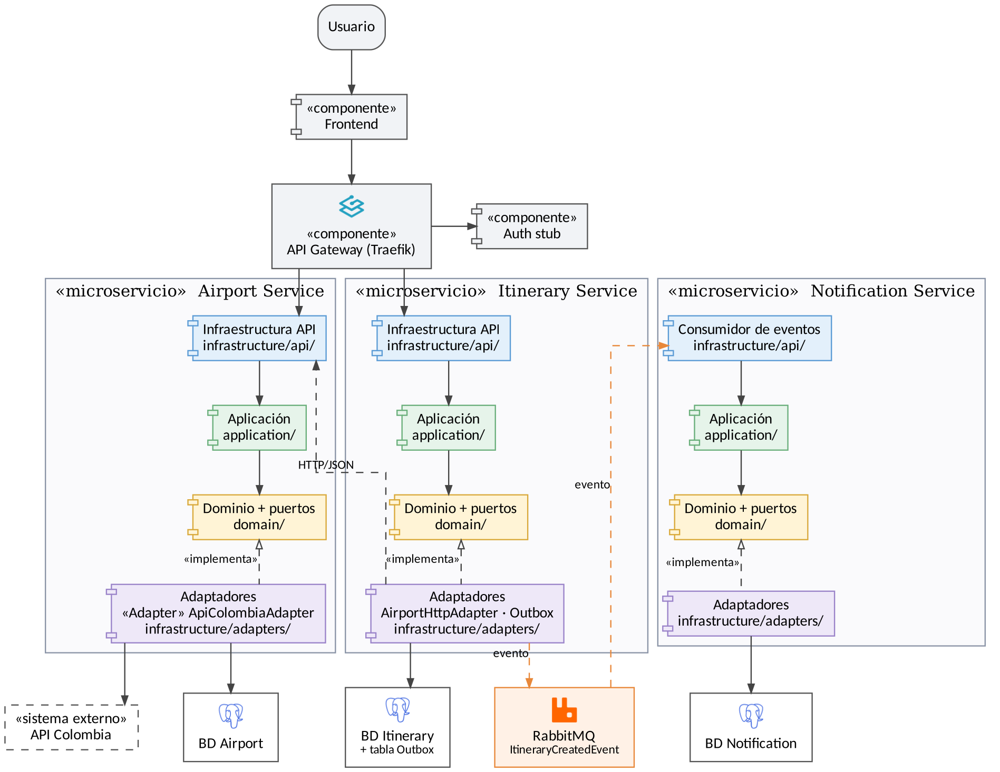
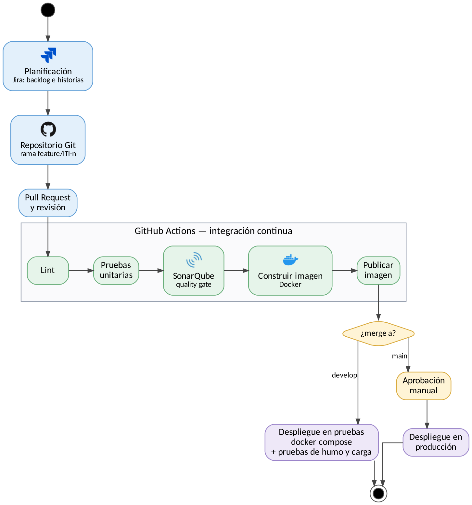

# Sistema de Itinerarios Personales

Monorepo de implementación del Sistema de Itinerarios Personales: una aplicación que expone el catálogo de aeropuertos de Colombia, lo visualiza en un mapa y permite gestionar los itinerarios de viaje de un usuario.

La especificación completa se encuentra en `docs/`. Este código es consistente con las decisiones cerradas en esos documentos (requerimientos, ADR, diseño, plan de blindaje de seguridad y ciclo DevOps) y no las redefine.

## Contenido

- [Arquitectura](#arquitectura)
- [Diagramas](#diagramas)
- [Reglas de arquitectura hexagonal](#reglas-de-arquitectura-hexagonal)
- [Aislamiento de API Colombia en airport-service](#aislamiento-de-api-colombia-en-airport-service)
- [Estado de la implementación](#estado-de-la-implementación)
- [Puesta en marcha](#puesta-en-marcha)
- [Pruebas](#pruebas)
- [Estrategia de ramas](#estrategia-de-ramas)
- [CI/CD](#cicd)
- [Estructura del repositorio](#estructura-del-repositorio)
- [Pendientes de verificación](#pendientes-de-verificación)

## Arquitectura

El sistema combina dos estilos de comunicación:

- **HTTP síncrono:** Frontend → API Gateway → Airport Service / Itinerary Service. Itinerary Service valida los aeropuertos consultando a Airport Service.
- **Eventos asíncronos:** Itinerary Service → Outbox → RabbitMQ → servicio de notificaciones.

| Componente | Responsabilidad |
|---|---|
| `frontend` | Aplicación web (Vite + React + TypeScript): mapa Plotly y gestión de itinerarios. |
| `gateway/traefik` | Punto único de entrada: enrutamiento, rate limiting y propagación del JWT. Sin lógica de negocio. |
| `services/auth-stub` | Emisor de JWT (HS256). No implementa gestión de identidad completa. |
| `services/airport-service` | Catálogo de aeropuertos. Arquitectura hexagonal, patrón Adapter sobre API Colombia, PostgreSQL y caché Redis. |
| `services/itinerary-service` | CRUD de itinerarios. Arquitectura hexagonal y patrón Transactional Outbox. |
| `services/notification-function` | Consumidor de eventos de RabbitMQ. Idempotente. Registra la notificación simulada. |

Cada servicio cuenta con base de datos propia, `Dockerfile` y `docker-compose.yml` propios, y valida el JWT de forma independiente.

## Diagramas

Los diagramas se mantienen en `docs/diagramas/`.

### Diagrama de arquitectura



Vista estática en notación UML de componentes, apta para documentos y presentaciones. Representa cada microservicio con sus cuatro capas (Infraestructura API, Aplicación, Dominio con puertos e Infraestructura de adaptadores), las relaciones «implementa» entre adaptadores y puertos, y el flujo de eventos mediante RabbitMQ.

### Ciclo DevOps



Diagrama de actividades del flujo de integración y despliegue continuo descrito en la sección [CI/CD](#cicd).

## Reglas de arquitectura hexagonal

Cada servicio con lógica de negocio (`airport-service`, `itinerary-service` y el servicio de notificaciones) se organiza en cuatro capas. La regla de dependencia es: **dominio ← aplicación ← infraestructura**. Ninguna capa interna conoce a las externas.

| Capa | Ruta | Regla |
|---|---|---|
| Dominio | `domain/` | Cero dependencias externas. No importa frameworks, drivers ni código de infraestructura. Contiene entidades, objetos de valor, invariantes y los puertos en `domain/ports.py`. |
| Aplicación | `application/` | Orquesta el dominio a través de los puertos definidos en `domain/ports.py`. Contiene los casos de uso. |
| Adaptadores | `infrastructure/adapters/` | Implementa los puertos del dominio: persistencia, caché, clientes HTTP, publicación y consumo de mensajes. |
| API | `infrastructure/api/` | Routers. Únicamente traducen HTTP ↔ casos de uso (validación de entrada, mapeo de respuestas y códigos de estado). No contienen lógica de negocio. |

Criterios de revisión en Pull Request:

- Un archivo en `domain/` que importe desde `infrastructure/` no se acepta.
- Un router que decida reglas de negocio no se acepta: esa decisión pertenece a un caso de uso o al dominio.
- Todo acceso a un recurso externo se hace a través de un puerto.

## Aislamiento de API Colombia en airport-service

El uso del patrón **Adapter** es obligatorio para consumir API Colombia. El formato de esa API no debe aparecer fuera del adaptador.

| Rol del patrón | Elemento |
|---|---|
| Target | `AirportRepositoryPort` (en `domain/ports.py`) |
| Adapter | `ApiColombiaAdapter` (en `infrastructure/adapters/`) |
| Adaptee | Cliente HTTP de API Colombia y su modelo externo |
| Cliente | Casos de uso `ListAirports` y `GetAirportById` |

Flujo:

```
API Colombia → ApiColombiaAdapter → AirportRepositoryPort → casos de uso → API de Airport Service
```

El adaptador traduce el JSON de API Colombia al modelo interno `Airport` (`id`, `iataCode`, `name`, `city`, `latitude`, `longitude`). El resto del sistema solo conoce `Airport`; si API Colombia cambia su contrato, únicamente se modifica el adaptador.

El catálogo adaptado se persiste en PostgreSQL y se sirve con caché Redis (cache-aside con TTL). Ante la caída de API Colombia, el servicio responde con los datos almacenados y aplica Circuit Breaker, timeout y reintentos con backoff.

## Estado de la implementación

| Sprint | Entregable | Pruebas | Build / lint |
|---|---|---|---|
| 1 | Airport Service (Adapter, Redis, Circuit Breaker) | 6/6 | — |
| 2 | Itinerary Service (Outbox, anti-IDOR, anti-mass-assignment) | 10/10 | — |
| 3 | Notificaciones (consumidor real de RabbitMQ) y Gateway | 2/2 | — |
| 4 | Auth stub (emisor JWT) | 5/5 | — |
| 5 | Frontend (Vite + React + TS, mapa Plotly, gestión de itinerarios) | 2/2 | build y lint OK |

**Total: 25/25 pruebas automatizadas en verde** en cinco servicios. La evidencia detallada está en `docs/matriz-estado.md`.

## Puesta en marcha

### Requisitos

- Docker y Docker Compose
- Node.js (frontend) y Python con `pip` (pruebas de los servicios)

### Configuración

Copiar cada `.env.example` a `.env` y completar los valores en:

- `services/auth-stub/`
- `services/airport-service/`
- `services/itinerary-service/`
- `services/notification-function/`
- `frontend/`

> **Importante:** `JWT_SECRET` debe tener exactamente el mismo valor en `services/auth-stub/.env` y en `services/itinerary-service/.env`. El primero emite el token y el segundo lo valida; si no coinciden, las peticiones fallan con `401`. Se recomienda generar un valor robusto:
>
> ```bash
> openssl rand -hex 32
> ```

### Despliegue local

```bash
docker network create itinerarios-net
docker compose up -d --build
```

### Verificación

```bash
# 1. Obtener un token
curl -X POST http://localhost/api/auth/token \
  -H "Content-Type: application/json" \
  -d '{"username":"jhon"}'

# 2. Listar aeropuertos (la primera consulta puede tardar: consulta API Colombia)
curl http://localhost/api/airports

# 3. Crear un itinerario
curl -X POST http://localhost/api/itineraries \
  -H "Authorization: Bearer <TOKEN>" \
  -H "Content-Type: application/json" \
  -d '{"nombre_usuario":"jhon","origin_airport_id":"<id-origen>","destination_airport_id":"<id-destino>","travel_date":"2026-12-01","duration_minutes":90}'
```

| Recurso | URL |
|---|---|
| Frontend | http://localhost:5173 |
| API (Gateway) | http://localhost/api/... |
| RabbitMQ (administración) | http://localhost:15672 |
| Swagger de cada servicio | Puerto directo del servicio + `/docs` (ver su `docker-compose.yml`) |

Las credenciales por defecto de RabbitMQ (`guest`/`guest`) son solo para desarrollo y deben reemplazarse antes de cualquier despliegue real (ver `docs/Plan_de_Blindaje_Seguridad.docx`, sección 4).

Ante un fallo de arranque, consultar primero `docker compose logs <servicio>`. Las causas más comunes son la red no creada, un puerto ocupado o un `.env` ausente.

## Pruebas

```bash
for s in airport-service itinerary-service notification-function auth-stub; do
  echo "== $s =="
  (cd services/$s && pip install -r requirements.txt -q && pytest tests/unit -v)
done

cd frontend && npm install && npm test && npm run build
```

Las pruebas unitarias cubren dominio y casos de uso con puertos simulados, sin base de datos, broker ni red. Las pruebas de carga y los umbrales de desempeño están definidos en `docs/Documento_Ciclo_DevOps.docx`.

## Estrategia de ramas

```
main ← develop ← feature/<historia>
```

- Todo cambio ingresa mediante Pull Request; `main` y `develop` están protegidas y no admiten push directo.
- Merge con `--no-ff` para conservar el historial (`git log --graph --all`).
- La clave de la historia (por ejemplo `ITI-12`) se incluye en la rama, los commits y el Pull Request.
- El checklist de seguridad está en `.github/pull_request_template.md`.

## CI/CD

El flujo se implementa con **GitHub Actions** y **SonarQube**. El detalle operativo está en `docs/Documento_Ciclo_DevOps.docx`.

### Integración continua (en cada Pull Request)

1. **Lint:** estilo y análisis de tipos.
2. **Pruebas unitarias:** dominio y casos de uso, con cobertura mínima del 70 %.
3. **SonarQube:** análisis estático y evaluación del Quality Gate.
4. **Construcción de imágenes Docker:** `Dockerfile` multi-stage por servicio.
5. **Publicación de imágenes** en el registro, versionadas por etiqueta.

El Pull Request no puede fusionarse si alguna etapa falla.

**Quality Gate:**

- Sin vulnerabilidades críticas
- Cobertura ≥ 70 % en código nuevo
- Duplicación < 3 %

### Despliegue continuo

| Evento | Acción |
|---|---|
| Merge a `develop` | Despliegue automático al ambiente de pruebas con `docker compose` y ejecución de pruebas de humo y de carga. |
| Merge a `main` | Despliegue a producción tras aprobación manual. |

Los secretos se gestionan como *secrets* del pipeline y nunca se versionan. El *rollback* consiste en redesplegar la imagen etiquetada anterior.

### Secretos requeridos por el pipeline

| Secreto | Uso |
|---|---|
| `SONAR_TOKEN` | Autenticación contra SonarQube. |
| `SONAR_HOST_URL` | URL de la instancia de SonarQube. |

## Estructura del repositorio

```
services/
  auth-stub/                # Emisor JWT (sin gestión de identidad completa)
  airport-service/          # Hexagonal + Adapter + Redis + PostgreSQL
  itinerary-service/        # Hexagonal + Transactional Outbox
  notification-function/    # Consumidor de RabbitMQ, idempotente
frontend/                   # Vite + React + TS, arquitectura en capas
gateway/traefik/            # Enrutamiento y rate limiting, sin lógica de negocio
docs/
  diagramas/                # Diagramas de arquitectura y ciclo DevOps
  matriz-estado.md          # Estado de implementación por sprint, con evidencia
jira/backlog.csv            # Backlog con columna de estado
```

## Pendientes de verificación

Los siguientes puntos requieren infraestructura que no estuvo disponible durante la construcción del repositorio (sin Docker, sin acceso a GitHub ni Jira, sin RabbitMQ ni PostgreSQL en ejecución):

| # | Pendiente | Referencia |
|---|---|---|
| 1 | Ejecución de `docker compose up -d --build` de punta a punta | [Puesta en marcha](#puesta-en-marcha) |
| 2 | Repositorio remoto en GitHub, ramas protegidas y ejecución de CI | [CI/CD](#cicd) |
| 3 | Proyecto en Jira e importación de `jira/backlog.csv` | `docs/Documento_Ciclo_DevOps.docx` |
| 4 | SonarQube real (token y host) para la evaluación del Quality Gate | `docs/Documento_Ciclo_DevOps.docx`, sección 5 |

Fuera de alcance por decisión documentada: registro de usuarios real (ver ADR del Auth stub).
