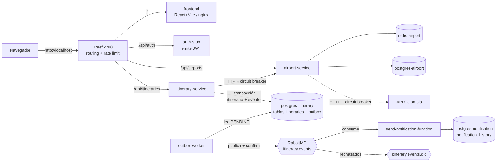

# Sistema de Itinerarios Personales

Monorepo de microservicios: el usuario inicia sesión, crea itinerarios entre
aeropuertos de Colombia, los ve en un mapa y recibe una notificación asíncrona
cuando se crea cada uno.

> Estado verificado y brechas: [`docs/matriz-estado.md`](docs/matriz-estado.md) ·
> Contexto del proyecto: [`context.md`](context.md)

## Arquitectura



| Servicio | Responsabilidad | Tecnología |
|---|---|---|
| `frontend` | Dashboard, mapa de aeropuertos, CRUD de itinerarios | React 18, TypeScript, Vite, Plotly, nginx |
| `traefik` | Único punto de entrada, rate limit (20 req/s, burst 40) | Traefik 3 (solo proveedor de archivo) |
| `auth-stub` | Emite JWT HS256 a partir de un nombre de usuario (**sin contraseña**: es un stub) | FastAPI |
| `airport-service` | Aeropuertos desde API Colombia con 3 niveles de resiliencia (Redis fresco → Redis stale → PostgreSQL) + circuit breaker | FastAPI, Redis, PostgreSQL |
| `itinerary-service` | CRUD de itinerarios (anti-IDOR, lista blanca de campos) + *Transactional Outbox* | FastAPI, PostgreSQL |
| `outbox-worker` | Relay outbox → RabbitMQ (confirms, `SKIP LOCKED`, reconexión) | Python, pika |
| `send-notification-function` | Consume el evento y registra la notificación (idempotente, DLQ) | Python, pika, psycopg2 |

Cada servicio con estado tiene su **propia base de datos** y su versión de
esquema con **Alembic**. Arquitectura hexagonal en los servicios FastAPI
(`domain` → `application` → `infrastructure`).

## Requisitos previos

Docker Desktop (o Engine) con Compose ≥ 2.20 (usa `include:`), `python3`
(solo para el script de entorno y las pruebas de humo) y, para desarrollar,
Python 3.11 y Node 20+.

## Arranque

```bash
./scripts/bootstrap-env.sh            # genera los .env con secretos aleatorios y crea la red itinerarios-net
docker compose up -d --build          # levanta los 12 contenedores
docker compose ps                     # esperar a que todos estén "healthy"
```

- Aplicación: <http://localhost> (también <http://localhost:5173>)
- RabbitMQ (consola): <http://localhost:15672> — usuario `itinerarios`, clave en `services/itinerary-service/rabbitmq.env`
- Swagger: <http://localhost:8001/docs> (aeropuertos), <http://localhost:8002/docs> (itinerarios), <http://localhost:8003/docs> (auth)

Los puertos de servicios y la consola de RabbitMQ solo escuchan en `127.0.0.1`.
Parar: `docker compose down` (conserva datos) · `docker compose down -v` (borra volúmenes).

**Sin internet / sin depender de API Colombia** (datos de prueba, ver `tools/mock_api_colombia.py`):

```bash
docker compose -f docker-compose.yml -f docker-compose.mock.yml up -d --build
```

### Variables de entorno

Plantillas `*.env.example` con marcadores `@@TOKEN@@`; `bootstrap-env.sh` los
sustituye. **`JWT_SECRET` debe ser idéntico** en `auth-stub` e `itinerary-service`
(lo garantiza el script); la clave de cada base y de RabbitMQ debe coincidir entre
servidor y cliente (idem). Los `.env` reales están en `.gitignore`.

| Archivo | Variables |
|---|---|
| `services/auth-stub/.env` | `JWT_SECRET` |
| `services/airport-service/.env` | `DATABASE_URL`, `REDIS_URL`, opcional `API_COLOMBIA_BASE_URL` |
| `services/airport-service/db.env` | `POSTGRES_DB/USER/PASSWORD` |
| `services/itinerary-service/.env` | `DATABASE_URL`, `RABBITMQ_URL`, `AIRPORT_SERVICE_URL`, `JWT_SECRET` (≥ 32 caracteres, se rechaza si es más corto), opcional `MIN_CONNECTION_MINUTES` (def. 0) |
| `services/itinerary-service/db.env`, `rabbitmq.env` | credenciales de PostgreSQL y de RabbitMQ |
| `services/notification-function/.env`, `db.env` | `DATABASE_URL`, `RABBITMQ_URL`; credenciales de PostgreSQL |
| `frontend/.env` | `VITE_API_BASE_URL` (vacío = mismo origen) |

## Migraciones y datos iniciales

Alembic por servicio (`airport-service`, `itinerary-service`, `notification-function`);
se aplican solas al arrancar el contenedor (`alembic upgrade head`) con un advisory lock.
La migración `0001_baseline` es idempotente y **adopta bases ya existentes sin borrar datos**.
Aplicar/revertir a mano y política: [`docs/migraciones.md`](docs/migraciones.md).
No hay datos semilla: los aeropuertos se cargan desde API Colombia en la primera consulta.

## API

| Servicio | Endpoints |
|---|---|
| auth | `POST /api/auth/token` `{"username": "...", "email": "opcional"}` → `{access_token, token_type, expires_in_minutes}` |
| airports | `GET /api/airports`, `GET /api/airports/{id}` (503 si el upstream y sus respaldos fallan) |
| itineraries (Bearer JWT) | `POST /api/itineraries` `{nombre_usuario, origin_airport_id, destination_airport_id, departure_at, duration_minutes}` (201 `{id}`), `GET /api/itineraries` (ordenado por salida; incluye `departure_at` y `arrival_at`), `GET/PUT/DELETE /api/itineraries/{id}` |
| todos | `GET /health` |

`departure_at` es un instante ISO 8601 **con zona** (p. ej. `2026-12-01T06:00:00-05:00`); la llegada
se calcula como salida + `duration_minutes`.

Errores: 401/403 sin token válido (el token debe traer `exp`), 404 si el itinerario no es
del usuario o el id no es UUID, 422 validación/aeropuerto inexistente/origen = destino/salida
sin zona o en el pasado, **409 si el vuelo no es coherente con tu agenda** (ver abajo),
502 si Airport Service no está disponible, 503 si la base de datos no responde.

## Agenda del viajero (un vuelo no puede contradecir a otro)

Al crear o editar un vuelo el servidor valida tu agenda (`app/domain/scheduling.py`) y responde
**409** `{detail, code, conflicting_itinerary_id}` si:

| `code` | Cuándo | Ejemplo (Bogotá → Valledupar, 6:00–8:00) |
|---|---|---|
| `OVERLAP` | se cruza en el tiempo con otro vuelo tuyo | salir a las 7:00 desde Tunja |
| `ORIGIN_MISMATCH` | no sales desde donde aterrizó tu vuelo anterior | 9:00 desde Tunja (estás en Valledupar) |
| `NEXT_MISMATCH` | no terminas donde sale tu vuelo siguiente | llegar a Medellín antes de un vuelo que sale de Bogotá |

Sí se permite salir desde Valledupar a las 8:00 (o cualquier hora posterior). `MIN_CONNECTION_MINUTES`
exige un margen mínimo entre aterrizar y volver a salir (0 por defecto). La validación corre **dentro de
la misma transacción**, con un bloqueo por usuario (`pg_advisory_xact_lock`), así que dos peticiones
simultáneas no pueden crear vuelos que juntos sean incoherentes (probado contra PostgreSQL real). El
frontend avisa antes de enviar, sugiere desde qué ciudad y hora puedes salir y estima la duración por
distancia (estimación, no un horario real de aerolínea); el servidor es la autoridad.
No se revalida al **borrar** un vuelo: quitar uno intermedio puede dejar tramos desconectados (decisión
consciente: el usuario pudo cancelar o viajar por otro medio).

**Alertas:** si inicias sesión con correo, se envía un recordatorio 24 h antes de la salida **real**
(`REMINDER_LEAD_HOURS`); si el vuelo sale en menos de 24 h, el aviso se envía de inmediato. El panel
muestra además el tiempo que falta para tu próximo vuelo.

## Mensajería y notificaciones

`POST /api/itineraries` guarda el itinerario **y** el evento `ItineraryCreatedEvent` en la
tabla `outbox` en **una sola transacción**. El `outbox-worker` lo publica en la cola
`itinerary.events` (confirms del broker) y `send-notification-function` inserta una fila en
`notification_history` (idempotente por `itinerary_id`; canal **`log-simulado`**) y programa el
recordatorio por correo (`reminders`, enviado por `reminder-worker` vía SMTP; Mailpit en Compose).
Los eventos `Updated`/`Deleted` reprograman/cancelan el recordatorio. Mensajes inválidos van a
`itinerary.events.dlq`.
Contrato completo: [`docs/asyncapi.yaml`](docs/asyncapi.yaml).

## Pruebas

```bash
# Backend (por servicio). Las pruebas de integración se activan con TEST_DATABASE_URL:
cd services/itinerary-service
pip install -r requirements-dev.txt
TEST_DATABASE_URL=postgresql://user:pw@localhost:5432/itinerary_test python -m pytest tests -v --cov

# Frontend
cd frontend && npm ci && npm run lint && npx tsc --noEmit && npm run test:coverage && npm run build

# Extremo a extremo sobre el sistema levantado (Compose por defecto)
export RABBIT_USER=itinerarios RABBIT_PASS=$(sed -n 's/^RABBITMQ_DEFAULT_PASS=//p' services/itinerary-service/rabbitmq.env)
python3 scripts/e2e_smoke.py        # login → itinerario → outbox → RabbitMQ → notificación, idempotencia, DLQ
python3 scripts/e2e_resilience.py   # cae RabbitMQ con itinerarios en curso; nada se pierde
```

Resultados y alcance reales: [`docs/matriz-estado.md`](docs/matriz-estado.md).

### Pruebas de carga (Locust)

`pip install -r requirements-load.txt`, procedimiento, perfiles y resultados en
[`docs/pruebas-de-carga.md`](docs/pruebas-de-carga.md); reportes en `docs/evidencias/locust/`.

## CI y calidad

GitHub Actions (`.github/workflows/ci.yml`): tests backend con Postgres real, frontend
(lint/tipos/tests/build/audit), build de Compose, E2E, gitleaks, trivy y SonarCloud
(opcional, requiere secretos). Detalle y secretos necesarios: [`docs/ci-y-calidad.md`](docs/ci-y-calidad.md).

## Guion de demostración

1. `./scripts/bootstrap-env.sh && docker compose up -d --build` y `docker compose ps` (todo *healthy*).
2. Abrir <http://localhost>, iniciar sesión con un nombre de usuario.
3. Ver el mapa de aeropuertos; crear un vuelo (origen ≠ destino, fecha y hora). Probar la agenda: crear Bogotá → Valledupar 6:00 y luego intentar otro que salga a las 7:00 (409) o desde otra ciudad a las 9:00 (409); salir desde Valledupar a las 8:00 sí funciona.
4. Ver el evento: `docker compose logs -f outbox-worker send-notification-function`.
5. Ver el registro: `docker compose exec postgres-notification psql -U notif -d notification -c "select * from notification_history"`.
6. Resiliencia: `docker compose stop rabbitmq`, crear itinerarios (la API responde), `docker compose start rabbitmq` y repetir el paso 5.
7. `python3 scripts/e2e_smoke.py` para la verificación automática.

## Limitaciones conocidas

- **`docker compose up` no se pudo ejecutar en el entorno donde se hizo esta entrega** (sin acceso a Docker Hub): se validó `docker compose config`, los lockfiles con `pip --require-hashes` y el sistema completo como procesos nativos. La primera ejecución real de Compose es un paso pendiente (ver matriz).
- Autenticación = stub sin contraseñas ni registro (decisión documentada). Cualquiera puede obtener un token con cualquier nombre.
- El correo de recordatorio se probó contra un sumidero SMTP propio (`tools/smtp_sink.py`), **no** contra Mailpit ni un SMTP real (no hay Docker Hub en el entorno de desarrollo).
- Los horarios son planificados por el usuario (la duración se estima por distancia); no hay datos reales de aerolíneas ni estado de vuelo. Todas las horas se interpretan en Colombia (UTC-5).
- Sin trazas distribuidas/métricas (solo logs JSON con `X-Trace-Id`); sin despliegue continuo ni URL pública.
- Rate limit de Traefik por IP: pruebas de carga contra los puertos directos, no por el gateway.
- Cola con DLQ: si existía una cola `itinerary.events` sin argumentos (versión anterior), borrarla (`docker compose down -v`) para evitar `PRECONDITION_FAILED`.
