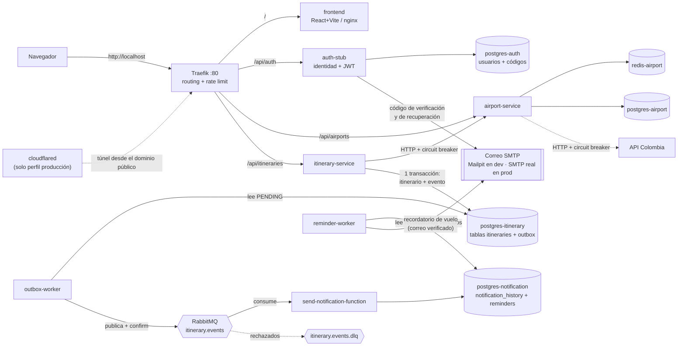
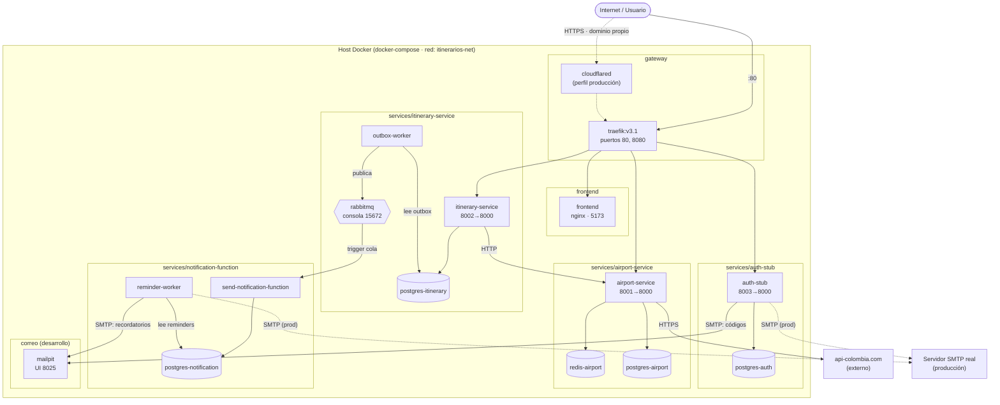
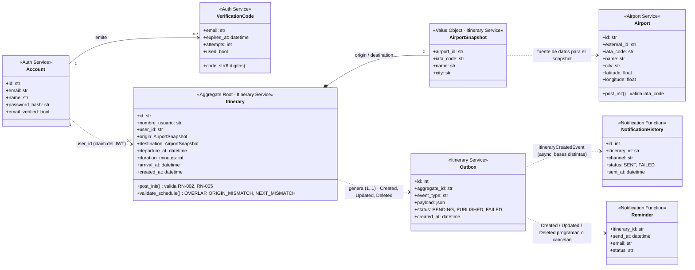
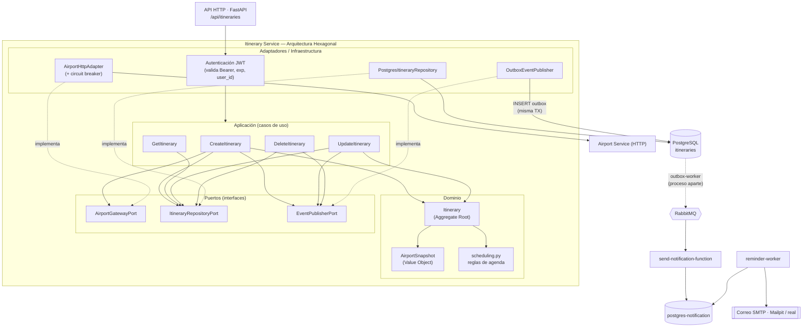
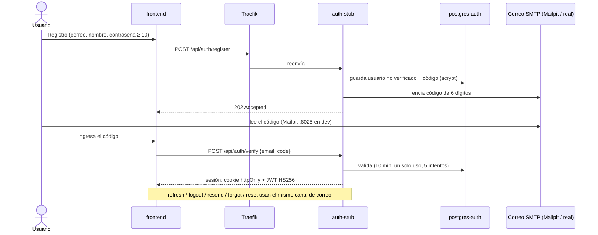
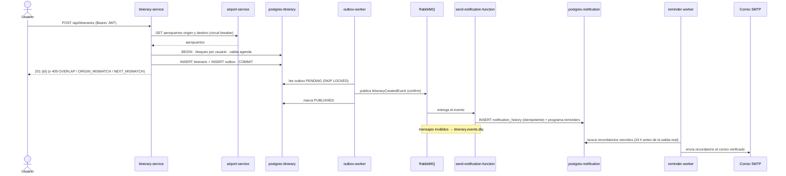
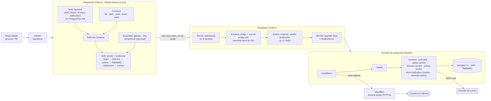
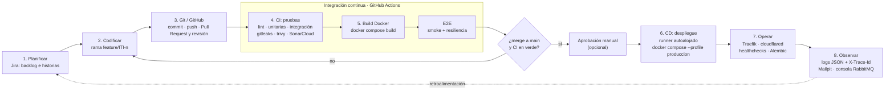

# Sistema de Itinerarios Personales

Monorepo de microservicios: el usuario inicia sesión, crea itinerarios entre
aeropuertos de Colombia, los ve en un mapa y recibe una notificación asíncrona
cuando se crea cada uno.

> Estado verificado y brechas: [`docs/matriz-estado.md`](docs/matriz-estado.md) ·
> Contexto del proyecto: [`context.md`](context.md)

## Arquitectura

La documentación de arquitectura se compone de seis vistas, todas en Mermaid (se
renderizan en GitHub): **(1)** arquitectura general, **(2)** despliegue Docker,
**(3)** clases del dominio, **(4)** arquitectura hexagonal del `itinerary-service`,
**(5)** flujos principales (secuencias) y **(6)** despliegue continuo (sección
[Despliegue continuo (CD)](#despliegue-continuo-cd)). Cada diagrama incluye **todos** los
sistemas de la aplicación, incluido el módulo de correo (SMTP / Mailpit, códigos de
verificación y recordatorios de vuelo).

### 1. Arquitectura general



**Explicación.** El navegador (o, en producción, el túnel `cloudflared`) solo habla con
**Traefik**, el único punto de entrada: enruta por prefijo (`/` → frontend, `/api/auth`,
`/api/airports`, `/api/itineraries`) y aplica el rate limit. Hay tres microservicios
HTTP y cada uno es dueño de su base de datos:

- **auth-stub** (identidad real) guarda usuarios y códigos en `postgres-auth` y envía por
  **correo SMTP** el código de verificación del registro y el de recuperación de contraseña.
- **airport-service** sirve los aeropuertos con tres niveles de resiliencia (Redis fresco →
  Redis *stale* → PostgreSQL) y un *circuit breaker* hacia API Colombia.
- **itinerary-service** valida la agenda y, en **una sola transacción**, guarda el itinerario
  y el evento en la tabla `outbox` (*Transactional Outbox*); consulta aeropuertos por HTTP
  con *circuit breaker*.

El flujo asíncrono: `outbox-worker` lee los eventos `PENDING`, los publica en RabbitMQ
(`itinerary.events`, con *confirms*) y `send-notification-function` los consume, registra
`notification_history` (idempotente) y programa el recordatorio en `reminders`. El
`reminder-worker` envía esos recordatorios por SMTP al correo **verificado** del usuario.
Los mensajes inválidos terminan en la DLQ `itinerary.events.dlq`. Ningún servicio comparte
base de datos con otro: se comunican solo por HTTP o por eventos.

| Servicio | Responsabilidad | Tecnología |
|---|---|---|
| `frontend` | Dashboard, mapa de aeropuertos, CRUD de itinerarios | React 18, TypeScript, Vite, Plotly, nginx |
| `traefik` | Único punto de entrada, rate limit (20 req/s, burst 40) | Traefik 3 (solo proveedor de archivo) |
| `auth-stub` | Identidad real: registro con **código por correo**, login con contraseña (scrypt), sesión por cookie `httpOnly`, emite JWT HS256. (El nombre `auth-stub` se conserva por compatibilidad con rutas, CI y documentación; ya no es un stub) | FastAPI + PostgreSQL (`postgres-auth`) |
| `airport-service` | Aeropuertos desde API Colombia con 3 niveles de resiliencia (Redis fresco → Redis stale → PostgreSQL) + circuit breaker | FastAPI, Redis, PostgreSQL |
| `itinerary-service` | CRUD de itinerarios (anti-IDOR, lista blanca de campos), validación de agenda + *Transactional Outbox* | FastAPI, PostgreSQL |
| `outbox-worker` | Relay outbox → RabbitMQ (confirms, `SKIP LOCKED`, reconexión) | Python, pika |
| `send-notification-function` | Consume el evento, registra la notificación (idempotente, DLQ) y programa el recordatorio | Python, pika, psycopg2 |
| `reminder-worker` | Envía por SMTP los recordatorios de vuelo programados (24 h antes de la salida real) | Python, SMTP |
| `mailpit` (solo desarrollo) | Captura los correos (códigos y recordatorios); UI en `:8025` | Mailpit |
| `cloudflared` (solo producción) | Túnel a Internet con dominio propio hacia Traefik | Cloudflare Tunnel |

Cada servicio con estado tiene su **propia base de datos** y su versión de
esquema con **Alembic**. Arquitectura hexagonal en los servicios FastAPI
(`domain` → `application` → `infrastructure`).

### 2. Diagrama de despliegue (Docker / docker-compose)



*Figura 2. Diagrama de despliegue (Docker / docker-compose).*

**Explicación.** Todos los contenedores viven en la red `itinerarios-net` de un mismo host
Docker. Solo Traefik (`:80`, dashboard `:8080`) recibe tráfico del usuario; en producción
`cloudflared` abre un túnel saliente desde el dominio propio hacia Traefik, así que no
se expone ningún puerto del host a Internet. Los puertos de los servicios (`8001`, `8002`,
`8003`), RabbitMQ (`15672`) y Mailpit (`8025`) escuchan solo en `127.0.0.1` y sirven para
Swagger y diagnóstico. Cada servicio con estado tiene su propia base (`postgres-auth`,
`postgres-airport`, `postgres-itinerary`, `postgres-notification`) más `redis-airport` como
caché. `itinerary-service` llama a `airport-service` por HTTP; este es el único que sale a
Internet hacia `api-colombia.com`. Los correos (códigos de verificación de `auth-stub`
y recordatorios de `reminder-worker`) van a **Mailpit** en desarrollo y a un SMTP real en
producción. Los perfiles de Compose (`docker-compose.mock.yml` para datos de prueba sin
API Colombia y el perfil de producción con `cloudflared`) cambian solo lo marcado en
punteado.

### 3. Diagrama de clases del dominio



*Figura 3. Diagrama de clases del dominio.*

**Explicación.** `Itinerary` es la **raíz de agregado** del `itinerary-service`: en su
inicialización valida las reglas de negocio RN-002 y RN-005 y, al crear o editar, la
coherencia de la agenda del viajero (`OVERLAP`, `ORIGIN_MISMATCH`, `NEXT_MISMATCH`). Sus
aeropuertos de origen y destino no son referencias al otro servicio sino
`AirportSnapshot` (*Value Object*): una copia inmutable de `airport_id`, `iata_code`, `name` y
`city` tomada de `Airport` en el momento de crear el vuelo, de modo que el itinerario sigue
siendo válido aunque el catálogo cambie. Al guardarse, el agregado genera **un** registro
`Outbox` en la misma transacción; ese evento viaja de forma asíncrona (las bases son
distintas) hasta `NotificationHistory` (registro idempotente por `itinerary_id`) y hasta
`Reminder` (recordatorio de correo que los eventos `Updated`/`Deleted` reprograman o
cancelan). `Account` y `VerificationCode` pertenecen al servicio de identidad: el itinerario
solo conoce al usuario por el `user_id` del JWT (sin clave foránea entre bases). Los
campos de `Account`, `VerificationCode` y `Reminder` son una representación a partir de lo
descrito en este README (código de 6 dígitos, vence en 10 min, un solo uso, 5 intentos);
conviene contrastarlos con los modelos reales del código.

### 4. Arquitectura hexagonal del `itinerary-service`



*Figura 4. Arquitectura hexagonal del `itinerary-service`.*

**Explicación.** El **dominio** (`Itinerary`, `AirportSnapshot` y las reglas de
`scheduling.py`) no depende de ningún framework ni de infraestructura. La capa de
**aplicación** orquesta los casos de uso (`CreateItinerary`, `GetItinerary` y los de
actualización y borrado) hablando únicamente con **puertos**: `AirportGatewayPort` (obtener
aeropuertos), `ItineraryRepositoryPort` (persistencia) y `EventPublisherPort` (publicar
eventos). Los **adaptadores** implementan esos puertos: `AirportHttpAdapter` llama a
`airport-service` por HTTP con *circuit breaker*, `PostgresItineraryRepository` persiste en
PostgreSQL y `OutboxEventPublisher` hace el `INSERT` en `outbox` **dentro de la misma
transacción** que el itinerario, de modo que nunca hay itinerario sin evento ni evento sin
itinerario. El adaptador JWT, en el borde, valida el token (con `exp`) y pasa el `user_id`
a los casos de uso (anti-IDOR). Publicar en RabbitMQ no es responsabilidad del servicio HTTP:
lo hace el `outbox-worker` en un proceso aparte, y de ahí el flujo continúa hacia
`send-notification-function`, `postgres-notification` y el `reminder-worker`, que envía el
correo por SMTP. Los demás servicios FastAPI (`auth-stub`, `airport-service`) siguen las
mismas capas `domain` → `application` → `infrastructure`.

### 5. Flujos principales

**5.1 Registro con código por correo y login**



**5.2 Crear un itinerario y notificar**



*Los eventos `Updated`/`Deleted` siguen el mismo camino y reprograman o cancelan el recordatorio.*

**Explicación.** El primer diagrama muestra por qué el correo es parte del sistema de identidad: sin el
código enviado por SMTP no hay sesión. El segundo muestra el contrato del *Outbox*: la
respuesta `201` ocurre tras el `COMMIT`; el resto es asíncrono y tolerante a fallos (si
RabbitMQ cae, los eventos quedan `PENDING` y se publican al volver). El recordatorio sale
24 h antes de la salida real o de inmediato si el vuelo sale en menos de 24 h.

## Requisitos previos

Docker Desktop (o Engine) con Compose ≥ 2.20 (usa `include:`) y un shell bash
(Git Bash o WSL en Windows) para `scripts/bootstrap-env.sh` (usa `openssl`, que
viene con Git Bash; no requiere Python). Python 3 solo hace falta para las pruebas
de humo (`scripts/e2e_*.py`) y, para desarrollar, Python 3.11 y Node 20+.

## Arranque

```bash
./scripts/bootstrap-env.sh            # genera los .env con secretos aleatorios y crea la red itinerarios-net
docker compose up -d --build          # levanta todos los contenedores (ver diagrama de despliegue)
docker compose ps                     # esperar a que todos estén "healthy"
```

- Aplicación: <http://localhost> (también <http://localhost:5173>)
- Correos de desarrollo (códigos y recordatorios, Mailpit): <http://localhost:8025>
- RabbitMQ (consola): <http://localhost:15672> — usuario `itinerarios`, clave en `services/itinerary-service/rabbitmq.env`
- Swagger: <http://localhost:8001/docs> (aeropuertos), <http://localhost:8002/docs> (itinerarios), <http://localhost:8003/docs> (auth)

Los puertos de servicios y la consola de RabbitMQ solo escuchan en `127.0.0.1`.
Parar: `docker compose down` (conserva datos) · `docker compose down -v` (borra volúmenes).

**Sin internet / sin depender de API Colombia** (datos de prueba, ver `tools/mock_api_colombia.py`):

```bash
docker compose -f docker-compose.yml -f docker-compose.mock.yml up -d --build
```

### Variables de entorno

Plantillas `*.env.example` con marcadores `@@TOKEN@@`; `bootstrap-env.sh` los
sustituye. **`JWT_SECRET` debe ser idéntico** en `auth-stub` e `itinerary-service`
(lo garantiza el script); la clave de cada base y de RabbitMQ debe coincidir entre
servidor y cliente (idem). Los `.env` reales están en `.gitignore`.

| Archivo | Variables |
|---|---|
| `services/auth-stub/.env` | `JWT_SECRET`, `DATABASE_URL` (+ `db.env`), SMTP (en desarrollo Mailpit) |
| `services/airport-service/.env` | `DATABASE_URL`, `REDIS_URL`, opcional `API_COLOMBIA_BASE_URL` |
| `services/airport-service/db.env` | `POSTGRES_DB/USER/PASSWORD` |
| `services/itinerary-service/.env` | `DATABASE_URL`, `RABBITMQ_URL`, `AIRPORT_SERVICE_URL`, `JWT_SECRET` (≥ 32 caracteres, se rechaza si es más corto), opcional `MIN_CONNECTION_MINUTES` (def. 0) |
| `services/itinerary-service/db.env`, `rabbitmq.env` | credenciales de PostgreSQL y de RabbitMQ |
| `services/notification-function/.env`, `db.env` | `DATABASE_URL`, `RABBITMQ_URL`, SMTP y `REMINDER_LEAD_HOURS` (usados por `reminder-worker`); credenciales de PostgreSQL |
| `frontend/.env` | `VITE_API_BASE_URL` (vacío = mismo origen) |

## Migraciones y datos iniciales

Alembic por servicio (`airport-service`, `itinerary-service`, `notification-function`);
se aplican solas al arrancar el contenedor (`alembic upgrade head`) con un advisory lock.
La migración `0001_baseline` es idempotente y **adopta bases ya existentes sin borrar datos**.
Aplicar/revertir a mano y política: [`docs/migraciones.md`](docs/migraciones.md).
No hay datos semilla: los aeropuertos se cargan desde API Colombia en la primera consulta.

## API

| Servicio | Endpoints |
|---|---|
| auth | `POST /api/auth/register` `{email, name, password}` (202; envía el código) · `POST /api/auth/verify` `{email, code}` → sesión · `POST /api/auth/login` `{email, password}` → `{access_token, token_type, expires_in_minutes, name, email}` (+ cookie `httpOnly`) · `POST /api/auth/refresh` (cookie → nuevo token) · `POST /api/auth/logout` · `POST /api/auth/resend` · `POST /api/auth/forgot` · `POST /api/auth/reset` `{email, code, password}` |
| airports | `GET /api/airports`, `GET /api/airports/{id}` (503 si el upstream y sus respaldos fallan) |
| itineraries (Bearer JWT) | `POST /api/itineraries` `{nombre_usuario, origin_airport_id, destination_airport_id, departure_at, duration_minutes}` (201 `{id}`), `GET /api/itineraries` (ordenado por salida; incluye `departure_at` y `arrival_at`), `GET/PUT/DELETE /api/itineraries/{id}` |
| todos | `GET /health` |

`departure_at` es un instante ISO 8601 **con zona** (p. ej. `2026-12-01T06:00:00-05:00`); la llegada
se calcula como salida + `duration_minutes`.

Errores: 401/403 sin token válido (el token debe traer `exp`), 404 si el itinerario no es
del usuario o el id no es UUID, 422 validación/aeropuerto inexistente/origen = destino/salida
sin zona o en el pasado, **409 si el vuelo no es coherente con tu agenda** (ver abajo),
502 si Airport Service no está disponible, 503 si la base de datos no responde.

## Cuentas y acceso
Se entra con **correo + contraseña** (mínimo 10 caracteres). Al registrarse llega un **código de 6 dígitos**
al correo (vence en 10 min, un solo uso, 5 intentos); sin verificarlo no hay sesión. En desarrollo el
correo lo captura **Mailpit**: <http://localhost:8025>. Hay recuperación de contraseña por código, bloqueo
temporal tras 5 contraseñas erróneas y sesión que sobrevive al refrescar (cookie `httpOnly`; el token JWT
vive solo en memoria). Los recordatorios de vuelo van al correo **verificado** de la cuenta.
Publicación en Internet con dominio propio y despliegue automático: [`docs/despliegue.md`](docs/despliegue.md).

## Agenda del viajero (un vuelo no puede contradecir a otro)

Al crear o editar un vuelo el servidor valida tu agenda (`app/domain/scheduling.py`) y responde
**409** `{detail, code, conflicting_itinerary_id}` si:

| `code` | Cuándo | Ejemplo (Bogotá → Valledupar, 6:00–8:00) |
|---|---|---|
| `OVERLAP` | se cruza en el tiempo con otro vuelo tuyo | salir a las 7:00 desde Tunja |
| `ORIGIN_MISMATCH` | no sales desde donde aterrizó tu vuelo anterior | 9:00 desde Tunja (estás en Valledupar) |
| `NEXT_MISMATCH` | no terminas donde sale tu vuelo siguiente | llegar a Medellín antes de un vuelo que sale de Bogotá |

Sí se permite salir desde Valledupar a las 8:00 (o cualquier hora posterior). `MIN_CONNECTION_MINUTES`
exige un margen mínimo entre aterrizar y volver a salir (0 por defecto). La validación corre **dentro de
la misma transacción**, con un bloqueo por usuario (`pg_advisory_xact_lock`), así que dos peticiones
simultáneas no pueden crear vuelos que juntos sean incoherentes (probado contra PostgreSQL real). El
frontend avisa antes de enviar, sugiere desde qué ciudad y hora puedes salir y estima la duración por
distancia (estimación, no un horario real de aerolínea); el servidor es la autoridad.
No se revalida al **borrar** un vuelo: quitar uno intermedio puede dejar tramos desconectados (decisión
consciente: el usuario pudo cancelar o viajar por otro medio).

**Alertas:** si inicias sesión con correo, se envía un recordatorio 24 h antes de la salida **real**
(`REMINDER_LEAD_HOURS`); si el vuelo sale en menos de 24 h, el aviso se envía de inmediato. El panel
muestra además el tiempo que falta para tu próximo vuelo.

## Mensajería y notificaciones

`POST /api/itineraries` guarda el itinerario **y** el evento `ItineraryCreatedEvent` en la
tabla `outbox` en **una sola transacción**. El `outbox-worker` lo publica en la cola
`itinerary.events` (confirms del broker) y `send-notification-function` inserta una fila en
`notification_history` (idempotente por `itinerary_id`; canal **`log-simulado`**) y programa el
recordatorio por correo (`reminders`, enviado por `reminder-worker` vía SMTP; Mailpit en Compose).
Los eventos `Updated`/`Deleted` reprograman/cancelan el recordatorio. Mensajes inválidos van a
`itinerary.events.dlq`.
Contrato completo: [`docs/asyncapi.yaml`](docs/asyncapi.yaml).

## Pruebas

```bash
# Backend (por servicio). Las pruebas de integración se activan con TEST_DATABASE_URL:
cd services/itinerary-service
pip install -r requirements-dev.txt
TEST_DATABASE_URL=postgresql://user:pw@localhost:5432/itinerary_test python -m pytest tests -v --cov

# Frontend
cd frontend && npm ci && npm run lint && npx tsc --noEmit && npm run test:coverage && npm run build

# Extremo a extremo sobre el sistema levantado (Compose por defecto)
export RABBIT_USER=itinerarios RABBIT_PASS=$(sed -n 's/^RABBITMQ_DEFAULT_PASS=//p' services/itinerary-service/rabbitmq.env)
python3 scripts/e2e_smoke.py        # login → itinerario → outbox → RabbitMQ → notificación, idempotencia, DLQ
python3 scripts/e2e_resilience.py   # cae RabbitMQ con itinerarios en curso; nada se pierde
```

Resultados y alcance reales: [`docs/matriz-estado.md`](docs/matriz-estado.md).

### Pruebas de carga (Locust)

`pip install -r requirements-load.txt`, procedimiento, perfiles y resultados en
[`docs/pruebas-de-carga.md`](docs/pruebas-de-carga.md); reportes en `docs/evidencias/locust/`.

## CI y calidad

GitHub Actions (`.github/workflows/ci.yml`): tests backend con Postgres real, frontend
(lint/tipos/tests/build/audit), build de Compose, E2E, gitleaks, trivy y SonarCloud
(opcional, requiere secretos). Detalle y secretos necesarios: [`docs/ci-y-calidad.md`](docs/ci-y-calidad.md).

## Despliegue continuo (CD)

El despliegue continuo publica la aplicación en Internet con dominio propio cada vez que
`main` pasa la integración continua. Procedimiento completo, secretos y recuperación:
[`docs/despliegue.md`](docs/despliegue.md).



**Ciclo DevOps del proyecto.**



*Figura 7. Ciclo DevOps del proyecto: planificar, codificar, integrar, construir, desplegar, operar y observar.*

**Cómo funciona.**

1. **Disparador:** un `push` o *pull request* ejecuta el CI. Los PR solo se validan; **solo `main` despliega**.
2. **Puerta de calidad:** el despliegue no empieza si falla algún trabajo del CI (tests con Postgres real,
   frontend, build de Compose, E2E, gitleaks, trivy).
3. **Despliegue por runner:** un *runner* autoalojado en el servidor de producción toma el trabajo, actualiza el
   código y ejecuta Compose con el perfil de producción. Como el runner ya está dentro del servidor, **no hace
   falta abrir puertos ni exponer SSH**.
4. **Migraciones y salud:** al arrancar cada contenedor aplica `alembic upgrade head` con *advisory lock*
   (la migración `0001_baseline` adopta bases existentes sin borrar datos) y Compose espera a que todos estén
   *healthy*.
5. **Publicación:** `cloudflared` expone Traefik en el dominio propio por un túnel **saliente** (HTTPS); Traefik
   sigue siendo el único punto de entrada.
6. **Correo en producción:** `auth-stub` (códigos) y `reminder-worker` (recordatorios) usan un SMTP real en lugar
   de Mailpit; las credenciales las pone el dueño del sistema como secretos del servidor.
7. **Verificación y recuperación:** tras el despliegue se puede correr `scripts/e2e_smoke.py`; para volver atrás
   se redespliega el commit anterior (los datos persisten en volúmenes; no usar `down -v` en producción).

| Elemento | Dónde vive | Notas |
|---|---|---|
| Secretos (`JWT_SECRET`, claves de BD y RabbitMQ, SMTP, token del túnel) | `.env` del servidor generados con `bootstrap-env.sh`, o secretos del repositorio | Nunca en Git (`.gitignore`, gitleaks); `JWT_SECRET` idéntico en `auth-stub` e `itinerary-service` |
| Runner | Servidor de producción | Etiqueta propia para que solo el trabajo de despliegue lo use |
| Dominio / HTTPS | Cloudflare + `cloudflared` | Opcional: Cloudflare Access / WAF contra abuso |
| Datos | Volúmenes Docker | Se conservan entre despliegues |

> **Pendiente:** el despliegue continuo y la URL pública están definidos pero **no se han verificado de
> extremo a extremo** (ver Limitaciones). Los nombres exactos de workflow, trabajo y perfil deben coincidir con
> `docs/despliegue.md` y `.github/workflows/`.

## Guion de demostración

1. `./scripts/bootstrap-env.sh && docker compose up -d --build` y `docker compose ps` (todo *healthy*).
2. Abrir <http://localhost>, registrarse con un correo, leer el código de 6 dígitos en Mailpit (<http://localhost:8025>) y verificar la cuenta; luego iniciar sesión.
3. Ver el mapa de aeropuertos; crear un vuelo (origen ≠ destino, fecha y hora). Probar la agenda: crear Bogotá → Valledupar 6:00 y luego intentar otro que salga a las 7:00 (409) o desde otra ciudad a las 9:00 (409); salir desde Valledupar a las 8:00 sí funciona.
4. Ver el evento: `docker compose logs -f outbox-worker send-notification-function`.
5. Ver el registro: `docker compose exec postgres-notification psql -U notif -d notification -c "select * from notification_history"`; y ver el recordatorio programado (`reminders`) y su correo en Mailpit.
6. Resiliencia: `docker compose stop rabbitmq`, crear itinerarios (la API responde), `docker compose start rabbitmq` y repetir el paso 5.
7. `python3 scripts/e2e_smoke.py` para la verificación automática.

## Limitaciones conocidas

- **Compose en desarrollo** lo ejecutó el autor en su equipo (`docker compose up`, todo sano) con la versión anterior; la versión con identidad real, el perfil de producción (`cloudflared`) y el despliegue por runner **no** se han ejecutado todavía en Docker: se probaron los servicios como procesos nativos (ver `docs/despliegue.md`, sección 7).
- Identidad: sin MFA, sin captcha y sin límite por IP real detrás del túnel (mitigaciones: tope de códigos por correo y global, bloqueo de cuenta; opcional Cloudflare Access/WAF, ver `docs/despliegue.md`).
- El correo se probó contra un sumidero SMTP propio (`tools/smtp_sink.py`), **no** contra Mailpit ni Gmail real (las credenciales las pone el dueño del sistema).
- Los horarios son planificados por el usuario (la duración se estima por distancia); no hay datos reales de aerolíneas ni estado de vuelo. Todas las horas se interpretan en Colombia (UTC-5).
- Sin trazas distribuidas/métricas (solo logs JSON con `X-Trace-Id`). Despliegue continuo y URL pública: definidos en `docs/despliegue.md` pero **no verificados** de extremo a extremo.
- Rate limit de Traefik por IP: pruebas de carga contra los puertos directos, no por el gateway.
- Cola con DLQ: si existía una cola `itinerary.events` sin argumentos (versión anterior), borrarla (`docker compose down -v`) para evitar `PRECONDITION_FAILED`.
