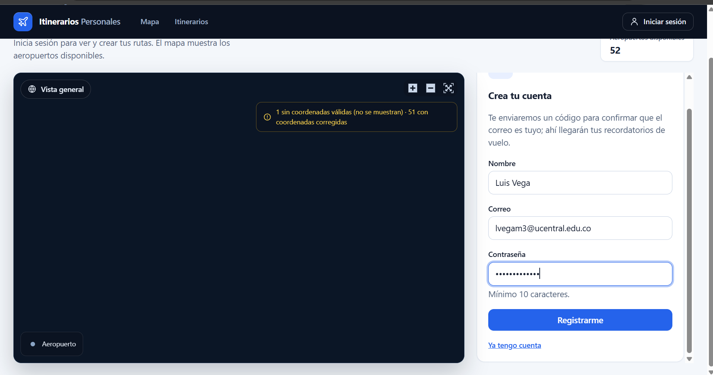
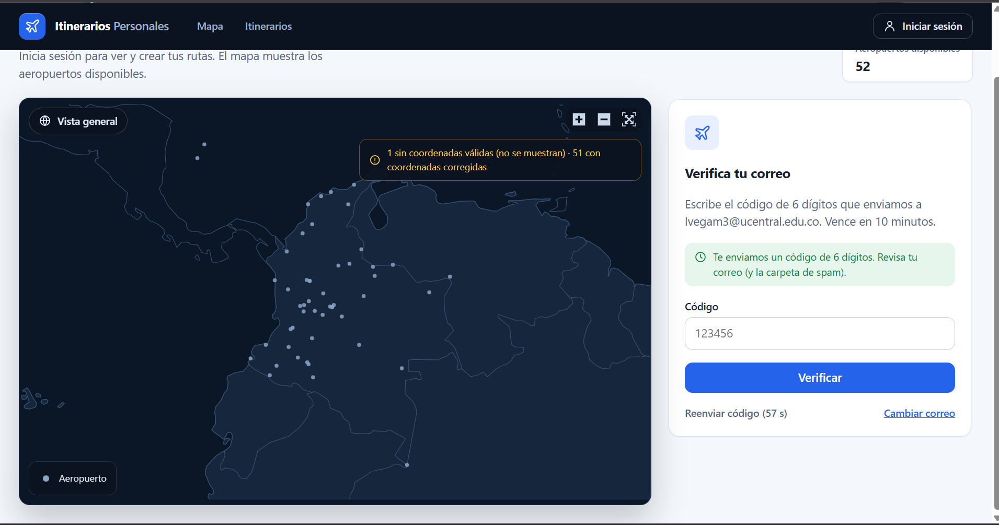
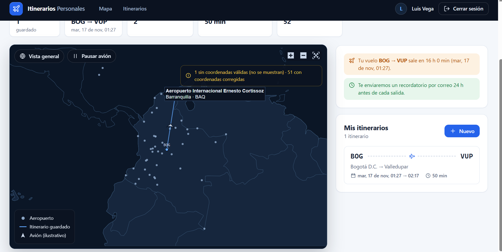
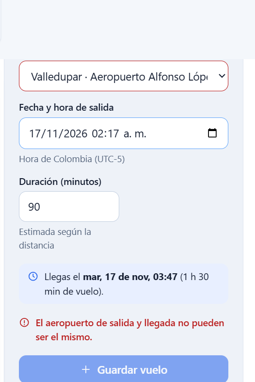
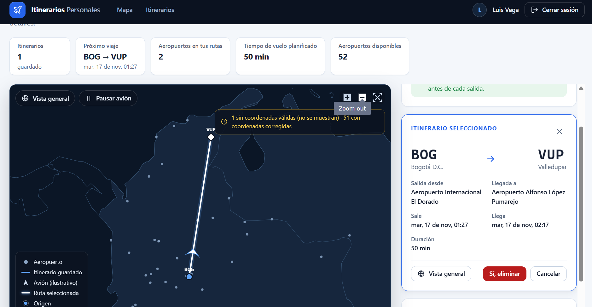
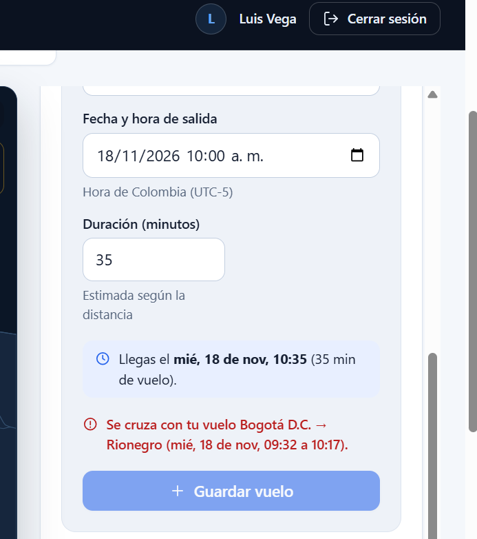
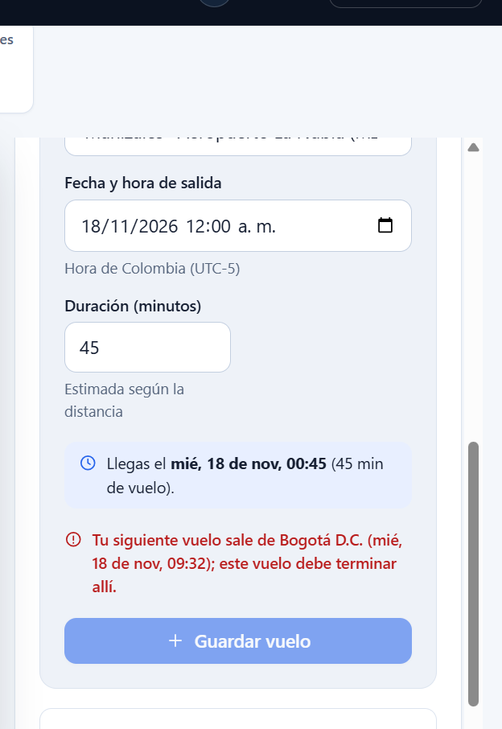

# Pruebas unitarias — Itinerarios Personales

Evidencias y resultados de las pruebas unitarias funcionales (paso a paso con capturas de pantalla).

## Resumen

| ID | Prueba | Evidencia |
|---|---|---|
| PU-01 | Registro de usuario | Figura 1 |
| PU-02 | Envío de código al correo | Figura 2 |
| PU-03 | Seleccionar vuelos | Figura 3 |
| PU-04 | Validación de que ambos aeropuertos no sean el mismo | Figura 4 |
| PU-05 | Detalle de itinerario seleccionado | Figura 5 |
| PU-06 | Validación de vuelos cruzados | Figura 6 |
| PU-07 | Validación cuando no sales desde donde aterrizó tu vuelo anterior | Figura 7 |

## PU-01 · Registro de usuario

| Campo | Detalle |
|---|---|
| **Objetivo** | Registrar una cuenta nueva con nombre, correo y contraseña. |
| **Procedimiento** | Diligenciar Nombre, Correo y Contraseña (mínimo 10 caracteres) en el formulario «Crea tu cuenta» y pulsar «Registrarme». |
| **Resultado** | El formulario se muestra con los datos diligenciados y el aviso de que se enviará un código para confirmar el correo. El resultado del envío se evidencia en PU-02. |
| **Evidencia** | Figura 1 |

*Figura 1. PU-01 — Formulario «Crea tu cuenta».* Imagen sin título en el documento original; descrita según su contenido visible.

## PU-02 · Envío de código al correo

| Campo | Detalle |
|---|---|
| **Objetivo** | Verificar que, tras el registro, el sistema envía un código de confirmación al correo. |
| **Procedimiento** | Registrar la cuenta (PU-01) y revisar la pantalla «Verifica tu correo». |
| **Resultado** | El sistema muestra el mensaje «Te enviamos un código de 6 dígitos. Revisa tu correo (y la carpeta de spam).», el campo «Código», el botón «Verificar», el aviso de vencimiento en 10 minutos y las opciones «Reenviar código» y «Cambiar correo». |
| **Evidencia** | Figura 2 |

*Figura 2. PU-02 — Pantalla «Verifica tu correo».*

## PU-03 · Seleccionar vuelos

| Campo | Detalle |
|---|---|
| **Objetivo** | Seleccionar y guardar un vuelo en el itinerario del usuario. |
| **Procedimiento** | Con la sesión iniciada, seleccionar el vuelo (aeropuertos de salida y llegada, fecha y hora de salida, duración) y guardarlo. |
| **Resultado** | El vuelo BOG → VUP (Bogotá D.C. → Valledupar, mar 17 de nov, 01:27 → 02:17, 50 min) queda en «Mis itinerarios» (1 guardado) y se dibuja en el mapa. El sistema informa que el vuelo sale en 16 h 0 min y que enviará un recordatorio por correo 24 h antes de cada salida. |
| **Evidencia** | Figura 3 |

*Figura 3. PU-03 — Itinerario guardado BOG → VUP.*

## PU-04 · Validación de que ambos aeropuertos no sean el mismo

| Campo | Detalle |
|---|---|
| **Objetivo** | Validar que el aeropuerto de salida y el de llegada no sean el mismo. |
| **Procedimiento** | En el formulario de vuelo, elegir el mismo aeropuerto (Valledupar · Aeropuerto Alfonso López) como salida y llegada, con salida 17/11/2026 02:17 a. m. y duración de 90 min. |
| **Resultado** | Se muestra el error «El aeropuerto de salida y llegada no pueden ser el mismo.» y el botón «Guardar vuelo» aparece atenuado. |
| **Evidencia** | Figura 4 |

*Figura 4. PU-04 — Error por aeropuertos iguales.*

## PU-05 · Detalle de itinerario seleccionado

| Campo | Detalle |
|---|---|
| **Objetivo** | Consultar el detalle de un itinerario guardado. |
| **Procedimiento** | Seleccionar el itinerario BOG → VUP guardado en PU-03. |
| **Resultado** | El mapa resalta la ruta seleccionada y el panel «Itinerario seleccionado» muestra: BOG → VUP; salida desde Aeropuerto Internacional El Dorado; llegada a Aeropuerto Alfonso López Pumarejo; sale mar 17 de nov, 01:27; llega mar 17 de nov, 02:17; duración 50 min. El panel ofrece «Vista general», «Sí, eliminar» y «Cancelar». |
| **Evidencia** | Figura 5 |

*Figura 5. PU-05 — Panel «Itinerario seleccionado».* Imagen sin título en el documento original; descrita según su contenido visible.

## PU-06 · Validación de vuelos cruzados

| Campo | Detalle |
|---|---|
| **Objetivo** | Validar que un vuelo nuevo no se cruce en el tiempo con otro ya guardado. |
| **Procedimiento** | En el formulario de vuelo, ingresar salida 18/11/2026 10:00 a. m. y duración de 35 min (llegada mié 18 de nov, 10:35). |
| **Resultado** | Se muestra el error «Se cruza con tu vuelo Bogotá D.C. → Rionegro (mié, 18 de nov, 09:32 a 10:17).» y el botón «Guardar vuelo» aparece atenuado. |
| **Evidencia** | Figura 6 |

*Figura 6. PU-06 — Error por cruce de horarios.*

## PU-07 · Validación cuando no sales desde donde aterrizó tu vuelo anterior

| Campo | Detalle |
|---|---|
| **Objetivo** | Validar la regla de agenda: cada vuelo debe salir desde donde aterrizó el anterior. |
| **Procedimiento** | En el formulario de vuelo, ingresar salida 18/11/2026 12:00 a. m. y duración de 45 min (llegada mié 18 de nov, 00:45). |
| **Resultado** | Se muestra el error «Tu siguiente vuelo sale de Bogotá D.C. (mié, 18 de nov, 09:32); este vuelo debe terminar allí.» y el botón «Guardar vuelo» aparece atenuado. |
| **Evidencia** | Figura 7 |

*Figura 7. PU-07 — Error de continuidad de la agenda.*
